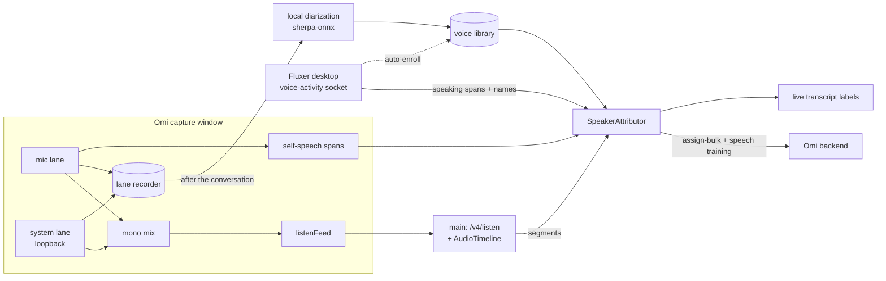

# Speaker identity for call capture (design)

Status: proposed, 2026-11-02. Scope: the Windows/Linux desktop app plus a fork of
Fluxer (a Discord-like chat app). It needs no Omi backend changes.

## Problem

In a voice call, Omi on Linux hears the user and everyone on the call through one
mono stream (a PipeWire mix of the mic and the headphone monitor). The backend
labels every line `SPEAKER_0`. The user wants:

1. their own voice told apart from the call;
2. each person on the call told apart, by name where possible;
3. voices saved, named, and recognized again in later recordings.

## What we know (measured 2026-11-02)

| Fact | Evidence |
|---|---|
| `/v4/listen` with `channels=2` (mic 0x01, system 0x02) is refused | Every probe across source × platform closed within ~1.5 s with `1011 transcription_service_unavailable` |
| Mono `/v4/listen` with `X-App-Platform: linux` transcribes live | `provider: parakeet`, segments arrive in about 3 s |
| The backend does not separate voices on this route | Two distinct espeak voices came back as one speaker on parakeet and on transcribe-stream |
| Segment `start`/`end` are conversation-offset seconds | `PATCH /v1/conversations/{id}/assign-speaker/{speaker_id}?start&end` documents that unit |
| The backend learns voices from manual assignments | `segments/assign-bulk {segment_ids, assign_type: is_user\|person_id, value}`, plus `use_for_speech_training` and `utils/speaker_assignment_teaching.py` |
| Electron loopback on Linux records the default sink's monitor | `getDisplayMedia` with `audio: 'loopback'` opened a PipeWire stream on the Bose sink's monitor |
| Fluxer knows who speaks, per participant | LiveKit `IsSpeakingChanged` / `ActiveSpeakersChanged`, plus a 50 ms local audio-level detector (`VoiceSpeakingDetection.ts`) |
| Fluxer's desktop app bundles its web client | `fluxer-app://app/` is served from `fluxer_desktop/dist/renderer`, with the hosted backend for the API |
| Offline diarization runs in Node | `sherpa-onnx-node` 2.0.1 (pyannote segmentation plus speaker embeddings and clustering) |

Speaker identity is therefore a client-side job. The server's contribution is
transcription, and learning voices once we tell it who spoke.

## Architecture



Every source of speaker evidence produces the same thing: a span of wall-clock
time attributed to a subject. One attributor maps transcript segments onto spans.
Sources can be added or fail independently, and nothing in the chain needs the
server's two-channel lane.

## Schemas

```ts
/** Wall-clock speaker evidence from any source. Epoch ms; one machine, one clock. */
type SpeakerSpan = {
  startMs: number
  endMs: number
  subject: SpeakerSubject
  source: 'mic-lane' | 'fluxer' | 'diarization'
  confidence: number // 0..1; fluxer audio-level ≈ 0.95, mic-lane ≈ 0.8, diarization = match score
}

type SpeakerSubject =
  | { kind: 'self' }
  | { kind: 'fluxer'; userId: string; name: string } // Fluxer snowflake + nickname
  | { kind: 'cluster'; conversationId: string; clusterId: number } // unnamed local voice
  | { kind: 'person'; personId: string; name: string } // Omi person (voice library hit)

/** Maps the audio the server heard back to wall-clock time, per conversation. */
type TimelineEntry = {
  clientConversationId: string
  offsetSec: number // conversation-offset seconds at the start of this chunk
  wallStartMs: number // when the chunk's first sample was captured
  samples: number // 16 kHz mono samples in the chunk
}

/** Local voice library row (omi.db `voice_profiles`). */
type VoiceProfile = {
  id: string
  personId: string | null // Omi person once linked (POST /v1/users/people)
  name: string
  model: string // embedding model id, e.g. '3dspeaker_campplus_en_16k'
  centroid: Float32Array // L2-normalized mean embedding
  sampleCount: number
  speechSec: number
  sources: Array<'fluxer' | 'manual' | 'self'>
  fluxerUserIds: string[] // auto-link: Fluxer identities seen speaking with this voice
  updatedAt: number
}
```

## Components

### 1. Lane separation with a mono mix (Omi capture window)

The existing `'call'` source already opens both lanes (`AudioSessionHost.startCallAudio`).
Phase 1 changes what is sent upstream: the two lanes are summed with clipping into one
16 kHz mono stream on a `channels=1` socket, which parakeet accepts. The VAD gate runs
on the mix. The PipeWire mix workaround then goes away. The two-channel framing
(`frameListenAudio`) stays, for the day the backend's `channels=2` lane works.

The lane recorder keeps each lane's PCM for the current conversation, so that
diarization only ever sees the call side and self-speech comes from the mic lane.
That costs 32 KB/s per lane in a ring file under userData, deleted after
diarization unless the user keeps it. Privacy: the files are local only, and
removed with the conversation.

### 2. AudioTimeline (Omi main process)

`feedSession` already sees every chunk the server receives. For each one it appends
a `TimelineEntry`, with `offsetSec` being cumulative samples ÷ 16000 since the
conversation began. The capture window stamps `wallStartMs` when it reads the
frame, because main-process arrival adds IPC delay. Converting a segment works like
this: binary-search the entry containing `segment.start`, then
`wall = wallStartMs + (start − offsetSec) × 1000`. Gated silence takes up no
offset, which is exactly what the mapping needs.

Phase 0 result (2026-11-02; espeak clips on parakeet, `client_conversation_id` set):

| Clip | Received-audio model | Elapsed-time model | Server `start` |
|---|---|---|---|
| 1 (first audio, 1.5 s after open) | 1.50 s | 1.50 s | 1.28 s |
| 2 (after 5 s with nothing sent) | 8.33 s | 13.48 s | 7.88 s |
| 3 (after 1.0 s of keepalives spread over 5 s) | 16.53 s | 25.76 s | 16.13 s |
| 4 (first audio on a reconnected socket, separate run) | 14.57 s | 34.99 s | 34.85 s |

What this establishes:

- Within one socket, the offset advances only with received audio, keepalive
  frames included (10 ms each). Gated silence takes no time.
- Each socket re-anchors at its first audio byte, to the elapsed time since the
  conversation started. The anchor carries across a reconnect that resumes the
  conversation.

So the timeline holds one anchor per socket (`firstAudioWallMs − conversationStartWallMs`)
plus fed samples, keepalives included. Parakeet's `start` ran 0.22–0.45 s early on
these clips. A fixed lead correction (about +0.35 s, to be calibrated on real speech)
brings them within ±0.12 s. `TimelineEntry` therefore also records keepalives and
socket boundaries.

### 3. Evidence sources

- **Mic lane, self.** A per-lane Silero verdict (the detector already exists in
  `captureEngine`). A span is self when the mic lane has speech and the system lane
  is quiet or much lower in level. This works without Fluxer.
- **Fluxer bridge.** See below. Gives named, per-person spans for Fluxer calls, and
  `isLocal` gives self too.
- **Local diarization.** Runs when a conversation ends, on the system lane only.
  sherpa-onnx (pyannote segmentation 3.0 plus a CAM++ embedding model) clusters the
  speech. Each cluster's centroid is matched to the voice library by cosine
  similarity, with an acceptance threshold and a margin over the runner-up, both
  tuned on real calls. Unmatched clusters remain `cluster` subjects.

### 4. SpeakerAttributor (Omi main or capture window)

For each segment (live, and again when the conversation ends):

1. Map `[start, end]` to wall time through the AudioTimeline.
2. Sum each subject's overlap with the segment, weighted by span confidence and a
   source priority (fluxer > mic-lane > diarization).
3. Assign a subject when it covers at least 60% of the segment and leads by a clear
   margin. Otherwise keep the server's label. Overlapping speech is left alone
   rather than guessed.
4. Live: relabel the line in `captureLiveStore` immediately (display only).
5. When the conversation ends, push assignments to the server in batches:
   - self → `assign-bulk {assign_type: 'is_user', value: 'true'}`
   - a named subject → resolve or create the Omi person
     (`GET/POST /v1/users/people`, cached by `fluxerUserId` and voice profile), then
     `assign-bulk {assign_type: 'person_id'}`, with speech training on, so Omi's own
     recognition improves too.

### 5. Voice library

The `voice_profiles` table lives in `omi.db`. Enrollment paths:

- **From Fluxer, automatically.** After diarization, a cluster that overlaps one
  Fluxer speaker by at least 80% of its speech is that person. Update the
  profile's centroid (a running mean weighted by speech seconds) and link the
  Fluxer user id. A person's voice is learned just by being on calls.
- **Manually.** The conversation view shows "Speaker A / B" chips for unmatched
  clusters, with a short sample clip. Naming one creates or links a profile and
  assigns those segments.
- **Self.** Enrolled from mic-lane self spans, which also guards against
  mislabelling the user's voice when it leaks into the call lane.

Matching rule: accept only above the threshold and with a clear margin over the
next profile. Refuse to auto-enroll from clusters shorter than about 8 s of speech.
Profiles store only embeddings, not audio.

### 6. Fluxer voice-activity bridge (Fluxer fork)

**Publisher (`fluxer_app`).** Hook `ParticipantEvent.IsSpeakingChanged` and the
audio-level detector (`isAudioLevelSpeaking`, 50 ms cadence: lower latency than the
server's active-speaker list) in `VoiceRoomEventBinder` /
`VoiceParticipantStateMachine`. Emit edge events through a new optional preload
method `window.electron.voiceActivity?(event)`. Its template is
`appendVoiceDebugEventSinkEntries` (`fluxer_desktop/src/preload/index.ts:495`). Names
come from `NicknameUtils.getNickname(Users.getUser(userId), guildId, channelId)`, and
streamer mode masks them.

**Server (`fluxer_desktop` main).** An opt-in desktop setting (a new
`local_integrations` group following the `window_behavior` pattern in
`DesktopConfig.ts`) starts a Unix socket server at
`$XDG_RUNTIME_DIR/<userDataName>/voice-activity.sock` (mode 0600; `fluxercanary` for
canary). It accepts `ipcMain.on('voice-activity:event')` from the app origin only (the
`DESKTOP_APP_ORIGIN` sender check) and writes JSON Lines to every connected client.

```ts
type FluxerVoiceActivityMessage =
  | { type: 'hello'; v: 1; app: 'fluxer'; channel: 'canary' | 'stable' }
  | { type: 'call'; state: 'joined' | 'left'; callId: string; guildId: string | null; channelId: string; channelName: string; ts: number }
  | { type: 'participants'; callId: string; ts: number; participants: Array<{ userId: string; connectionId: string; name: string; isLocal: boolean }> }
  | { type: 'speaking'; callId: string; ts: number; userId: string; connectionId: string; speaking: boolean; signal: 'audio-level' | 'livekit' }
```

`ts` is `Date.now()` at the edge, since both apps share the machine clock. A new
client gets `hello`, plus the current `call` and `participants` if a call is active.

**Subscriber (Omi main).** A `FluxerVoiceActivityClient` reconnects with backoff
when the socket isn't there, turns speaking edges into `SpeakerSpan`s
(`subject.kind = 'fluxer'`, or `'self'` when `isLocal`), and keeps them for the
conversation. An Omi setting turns the integration on.

**Building and replacing the installed app.** Build from the fork:
`pnpm install` at the root, then `BUILD_CHANNEL=canary pnpm build` in
`fluxer_desktop`, then `electron-builder --linux --x64`. Leave `FLUXER_MODULES`
unset, because with it on the app downloads newer official web-client modules and
silently replaces the modified one. Disable the shell self-update
(`ShellUpdateCapability`) in the fork, or the official feed will replace the
AppImage. Keep a backup of `~/Applications/Fluxer-Canary.AppImage` before swapping.
The build needs Rust, a wasm32 C toolchain and the Linux native-addon dependencies
listed in `tools/ci/src/desktop.rs`.

## Phases and acceptance

| Phase | Deliverable | Done when |
|---|---|---|
| 0 | Time-base spike (done 2026-11-02, see AudioTimeline) | Model confirmed. Raw error was 0.22–0.45 s early, and about ±0.12 s with a lead correction. Calibrate on real speech in Phase 1 |
| 1 | Mono-mix call source, lane recorder, AudioTimeline, mic-lane self attribution, display relabel, `is_user` assign | In a real Fluxer call the user's lines show as You and the rest as one other speaker, with no PipeWire workaround |
| 2 | Fluxer bridge (fork) and Omi client, person resolution, `person_id` assign with training | Each friend's lines carry their Fluxer nickname, live and in the saved conversation |
| 3 | Local diarization, voice library, naming UI, auto-enrollment from Fluxer | In a non-Fluxer recording, a friend enrolled through earlier Fluxer calls is named without the bridge |
| 4 | Cleanup | PipeWire mix removed; the listen-platform fix and the useful parts proposed upstream |

## Risks and open questions

- **Time base:** Phase 0 exists to settle it. If the server's offset does not track
  fed audio, fall back to arrival-time attribution with a measured STT latency,
  which is coarser and drops very short turns.
- **Speech training needs server-side audio:** if the account doesn't store audio,
  assignments still label segments but Omi's own voice learning may not run. The
  local voice library doesn't depend on it.
- **Segment granularity:** parakeet merged clips separated by 1.5 s of
  in-stream silence into one segment, and split them at 4 s. Segments carry no word
  timings, so a quick back-and-forth can put two speakers in one segment, which can
  only take the dominant speaker. Mitigations, by cost: leave mixed segments
  unassigned when no subject reaches 60%; for the local view, re-transcribe the
  call lane locally with word timings (sherpa-onnx or Whisper) and split there.
- **Live versus final segments:** live segments are rewritten (same id, longer text)
  and sometimes deleted (`segments_deleted`). Display relabels follow the id;
  server assignments wait for the conversation to end.
- **Crosstalk:** overlapping speech stays unassigned rather than guessed.
- **Fluxer updates:** a fork build must not be replaced by official module or
  shell updates (see above). Rebase the fork periodically.
- **Privacy:** the Fluxer socket carries call membership and names. It is opt-in,
  per-user (0600 in `XDG_RUNTIME_DIR`), and holds no audio. Lane recordings and
  embeddings stay on the machine.
- **Two-channel backend lane:** if it comes back, Phase 1 can switch upstream to
  `channels=2` for server-side you/them labels. The attributor still adds names.
